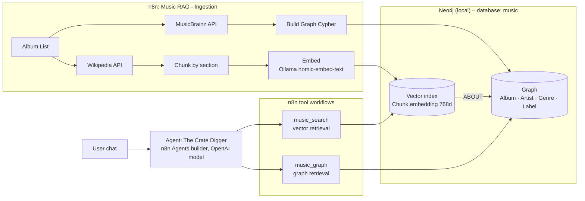

# Music RAG – "The Crate Digger"

**Case:** a knowledge base of 12 bass-heavy funk, soul and pop albums from 1976–1993 (Michael Jackson, Quincy Jones, Stevie Wonder, The Brothers Johnson, Chic, Earth Wind & Fire, Level 42, Prince, Toto, George Benson, Marcus Miller).
Music suits graph + vector RAG well: **credits are connections** (who produced, who played bass) and **sound and history are meaning** (what an album sounds like, how it was received).

**Agent role:** *The Crate Digger*, an expert music historian behind the counter of a record store. It answers questions about the collection using only what its two retrieval tools return, and cites MusicBrainz and Wikipedia sources.

## Architecture

| Component | What it does | Runs on |
|---|---|---|
| **Ingestion workflow** | Wipes the database, then loads the 12 albums: MusicBrainz credits → graph, Wikipedia articles → chunks + embeddings, linked by `(:Chunk)-[:ABOUT]->(:Album)` | n8n (Docker) |
| **music_search** (vector retrieval) | Embeds the question, returns the 5 most similar Wikipedia passages with score and source URL | n8n + Ollama + Neo4j |
| **music_graph** (graph retrieval) | Returns every connection of one album, artist, genre or label as facts, with MusicBrainz source URLs | n8n + Neo4j |
| **Agent** | Chooses and chains the two tools, answers with sources | n8n Agents builder, OpenAI model |
| **Neo4j** | One database `music` holding both the graph and the vector index | Neo4j Desktop (local) |
| **Ollama** | Embeddings (`nomic-embed-text`) for ingestion and search | Local (Mac) |

Data and embeddings stay local; only the agent's reasoning runs in the cloud.

## Where to find everything

| Requirement | Location |
|---|---|
| Workflow screenshots | [`screenshots/`](screenshots/) |
| Workflow JSON | [`workflows/`](workflows/) |
| Agent configuration (model, instructions, tools, skills) | [`agent/`](agent/) |
| Agent screenshots (tool connections) | [`screenshots/`](screenshots/) |
| Development prompts | [`prompts/development-prompts.md`](prompts/development-prompts.md) |
| Three example questions and results | [`examples/example-questions.md`](examples/example-questions.md) |
| Data sources, schema, sample | [`data/`](data/) |
| Setup: recreate Neo4j data and indexes | [`setup/SETUP.md`](setup/SETUP.md), [`setup/neo4j-setup.cypher`](setup/neo4j-setup.cypher) |

## Key design choices

- **Two sources, each for what it does best:** MusicBrainz for exact credits (graph), Wikipedia for descriptive text (vector).
- **Chunking by the article's own sections**, skipping Personnel / Track listing / References (already in the graph, or noise). Each chunk is prefixed "Artist - Album (Section):" for context.
- **Normalisation:** one `Artist` label for people and bands keyed on the MusicBrainz ID; instrument names mapped to a small set (`electric bass guitar` → `bass`); `MERGE` + unique constraints.
- **Fixed, parameterised graph queries** instead of letting the LLM write Cypher: safer and more reliable.
- **Earliest official release** from MusicBrainz, so reissues don't give wrong years or reissue producers.
- **One transaction per database** in ingestion, to avoid Neo4j deadlocks on shared artists.
